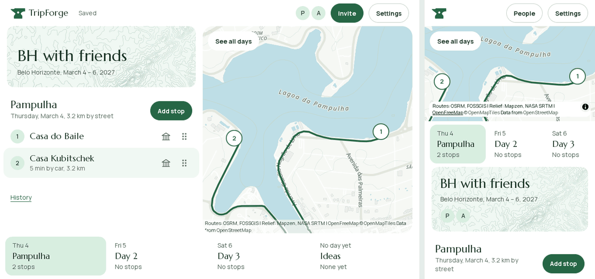

# TripForge

A collaborative trip planner: a group builds the itinerary day by day, together and in real time, with every stop on a map.



> **Status:** ready to launch. Friends plan a trip together, live: itinerary, map with street routes, invites, presence, conflicts, offline edits and history. It can be installed on a phone.

## Stack

| Part | Choice |
| --- | --- |
| Web | Next.js (App Router), TypeScript, Tailwind CSS |
| Languages | next-intl, English and Brazilian Portuguese |
| Sign-in | Better Auth with email and password |
| Database | PostgreSQL 16 with Drizzle |
| Realtime | Socket.IO on its own Node server |
| Tests | Vitest and Playwright |
| Hosting | Docker Compose and Caddy on one ARM VM |

## Layout

```
apps/web         Next.js app
apps/realtime    Socket.IO server
packages/core    Domain types, operations and the realtime token, shared by both apps
packages/db      Drizzle schema, migrations and the only code that changes a trip
infra            Dockerfile, Compose file, Caddyfile, backups and the server update
```

## Run it locally

You need Node 22 or newer and pnpm. Docker is not required: `db:dev` starts a real Postgres 16 from an npm package.

```bash
pnpm install
cp .env.example .env     # fill in the two secrets
pnpm db:dev              # keep running in its own terminal
pnpm db:migrate
pnpm dev                 # http://localhost:3000
```

## Checks

```bash
pnpm lint
pnpm typecheck
pnpm test
pnpm --filter @tripforge/web exec playwright install chromium   # once
pnpm test:e2e
```

## How a trip changes

Every change is a small operation (`item.move`, `item.update`, `day.update`...). The screen applies it at once and sends it; the server locks the trip, checks the role, applies it, gives it the next revision and logs it, all in one transaction. Each operation carries an id, so a retry is never applied twice. Order inside a day is a fractional index: moving a stop changes one row, and the server separates two stops dropped on the same spot.

## How it stays live

1. The browser applies a change at once, keeps it in a queue that survives a reload, and posts it.
2. The server applies it in a transaction, gives it the next revision and calls `pg_notify`.
3. The realtime server hears the notice, reads the new log entries and sends them, in order, to everyone with the trip open. Notices carry no data, so a lost one costs nothing.
4. Each browser applies entries strictly by revision. A gap, a reconnection or a tab coming back is filled from `GET /api/trips/:id/log`.

| When | What happens |
| --- | --- |
| Two people edit different fields | Both survive: only changed fields travel |
| Two people edit the same field online | The last to arrive wins, and the other is told |
| An offline edit meets a newer one | The newer stays; the author sees both and chooses |
| Someone edits a deleted stop | The deletion wins, with an undo |
| Two stops land on the same spot | The server moves one right after the other |
| Someone is removed | Their screen closes at once, and their invite links die |

## Outside services

All of them are free, need no key and can be replaced with an environment variable.

| What | Default | Variable |
| --- | --- | --- |
| Map | [OpenFreeMap](https://openfreemap.org) | `MAP_STYLE_URL` |
| Place search | [Photon](https://photon.komoot.io) | `PHOTON_URL` |
| Street routes | [OSRM at FOSSGIS](https://routing.openstreetmap.de) | `ROUTING_URL` (`off` draws straight lines) |
| Relief | [Terrain Tiles](https://registry.opendata.aws/terrain-tiles/) | `TERRAIN_URL` |
| Email | none, so password recovery is off | `SMTP_URL`, `MAIL_FROM` |

The public Photon and OSRM servers are run on goodwill: searches are cached and limited per person, and routes go through one queue of at most one request a second and are stored forever. Host your own, or pay for one, before charging anyone.

## How sockets are authenticated

The web app exchanges the session cookie for a JWT that lasts five minutes (`GET /api/realtime-token`). The realtime server accepts a connection only with that token, closes the socket when it expires, and lets the client extend it with `session.renew`, for the same user only.

## Deploy

Every push to `main` runs the checks, boots the full Compose stack on an ARM runner and proves that a backup can be restored. If the repository variable `DEPLOY_ENABLED` is `true`, it also publishes the images to GHCR and updates the server over SSH.

On the server, once: install Docker, open ports 80 and 443, create `/opt/tripforge` owned by the deploy user, save `infra/.env.example` there as `.env` with real values and mode 600, and authorize a key made only for deploys.

Repository secrets: `DEPLOY_HOST`, `DEPLOY_USER`, `DEPLOY_SSH_KEY` and `DEPLOY_KNOWN_HOSTS` (the server's `/etc/ssh/ssh_host_ed25519_key.pub`, with the host name in front).

The server reads the images with the job's own short-lived token, so nothing stays logged in.

## Backups

The database is saved every day at 06:00 UTC, checked, and kept for 14 days. Set `BACKUP_UPLOAD_URL` to also send each copy somewhere else with HTTP PUT; without it, copies live and die with the machine.

```bash
cd /opt/tripforge
docker compose exec backup backup.sh                      # now
docker compose exec backup ls /backups
docker compose exec backup restore.sh tripforge-….dump    # replaces the database
```

## License

Source-available under the [PolyForm Strict License 1.0.0](LICENSE): you may read the code and use it for noncommercial purposes, but not change it, redistribute it or use it commercially.
